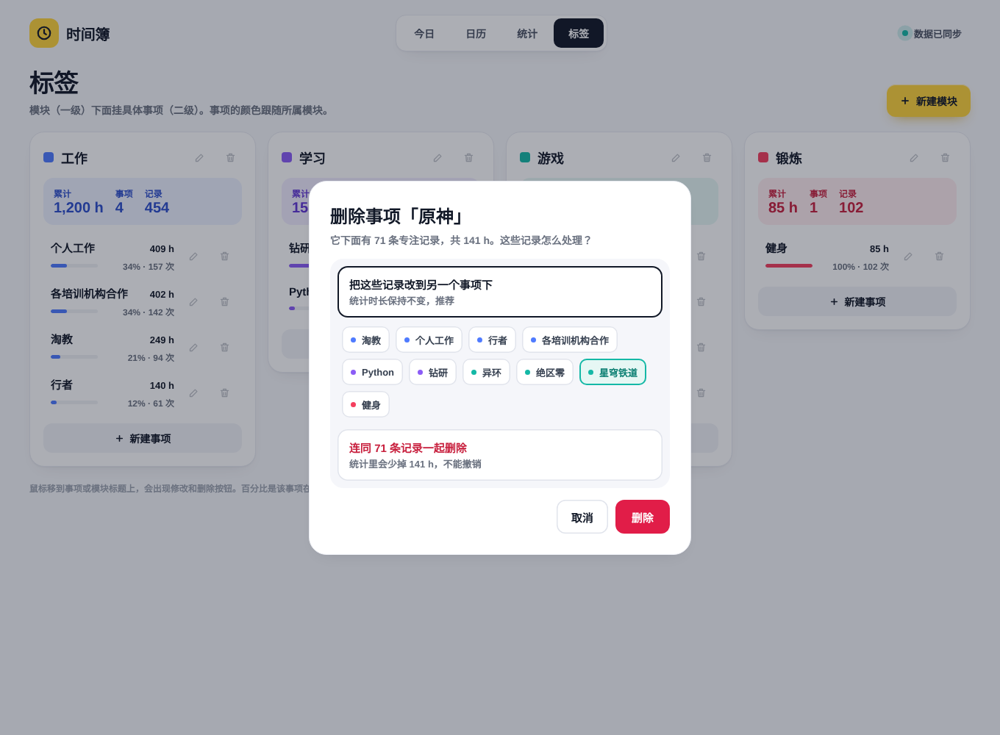

# 时间簿 Timebook

个人时间记录与可视化工具，用来替代原来在 Notion 里搭的「个人时间可视化管理」。

- 多个计时可以同时进行，先开始、再选标签
- 自动标出漏记的空档，一点就补；日历里拖一下也能补
- 日 / 周 / 月 / 年统计实时计算，不用归档
- 模块与事项两级标签，可增删改，删除时可迁移记录
- 多设备同步，右上角「数据已同步」随时监控数据是否安全保存

## 文档

- [当前有效文档索引](docs/README.md)：版本状态、设计、实施/测试计划与验收记录总入口
- [绿联 NAS 部署指南](docs/绿联NAS部署指南.md)：图形界面一键容器部署、Notion 历史数据导入与 Tailscale 免费 HTTPS 手机全屏配置
- [v1.0.0 工作流程与能力总览](docs/deliveries/timebook-v1.0.0-workflow-capability-overview.md)：实际架构、日常机制与测试实例说明
- [开发方案](docs/开发方案.md)：原始需求规则、数据模型与同步策略
- [设计规范](docs/设计规范.md)：颜色角色、字号、圆角、阴影、动效

## 原型

`prototype/` 里是交互原型的源码（Claude 设计画布格式，需要在画布里运行，这里仅作开发参考）。截图：

| 今日 | 补记录 |
| --- | --- |
|  |  |

| 日历（拖动补记录） | 统计 |
| --- | --- |
|  |  |

| 标签 | 删除事项 |
| --- | --- |
|  |  |

## 快速启动与部署

- **绿联 NAS / Docker 部署（推荐）**：修改 `docker-compose.yml` 中的 `TIMEBOOK_PASSWORD` 与 `TIMEBOOK_SECRET`，挂载数据目录启动即可（详见 [绿联 NAS 部署指南](docs/绿联NAS部署指南.md)）。
- **本地构建与运行**：
  ```bash
  corepack pnpm install --frozen-lockfile
  corepack pnpm test
  corepack pnpm build
  TIMEBOOK_PASSWORD=your-pass TIMEBOOK_SECRET=your-secret node apps/api/dist/server.js
  ```

## 状态

`v1.0.0` 一期完整版已验收交付（含今日 / 日历 / 统计 / 标签四主视图、移动端响应式与 PWA、Notion 三表历史导入对账与整批撤销、30 天回收站、每日自动热备与绿联 NAS 容器部署套件）。详见 [当前有效文档索引](docs/README.md) 与 [v1.0.0 验收记录](docs/deliveries/timebook-v1.0.0-acceptance.md)。
