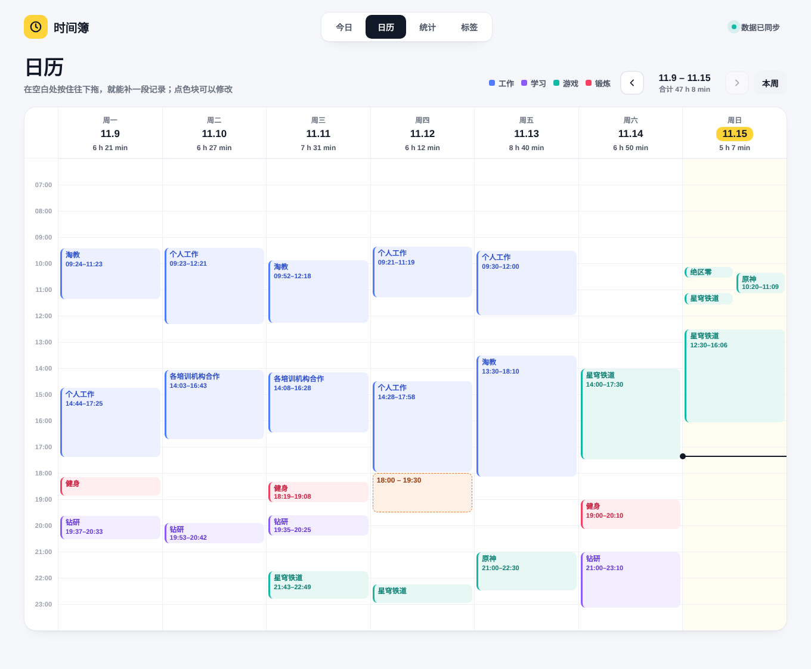
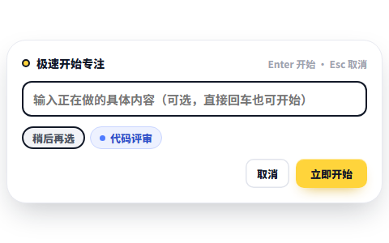

# 时间簿 Timebook

<p align="left">
  <strong>轻量、私密、高颜值的个人时间记录、历史复盘、可视化统计与待办管理工具</strong><br/>
  支持 <b>Windows 桌面单机开箱直用</b> · <b>Docker / NAS 自托管多端实时同步</b> · <b>手机全屏 PWA</b>
</p>

<p align="left">
  <a href="https://github.com/kkuxb/timebook/releases/latest">下载 Windows 桌面版 (v0.2.0)</a> ·
  <a href="docs/Windows桌面版使用说明.md">桌面版使用说明</a> ·
  <a href="docs/绿联NAS部署指南.md">NAS / Docker 部署指南</a> ·
  <a href="docs/设计规范.md">设计规范</a>
</p>

---

## 为什么做「时间簿」？

过去在 Notion 里搭建「个人时间可视化管理」时，常常遇到打开慢、移动端操作繁琐、跨天统计失真、多任务并行难记、漏记空档难察觉等痛点。

**时间簿（Timebook）** 将整套时间记录与复盘体验重新打磨成了一款响应迅速、数据完全掌握在自己手里的开源工具：
- **没有服务器也能立刻用**：安装约 **2.2 MB** 的 Windows 桌面版，双击免配置即可单机记录，自带双重本地文件防丢备份；
- **有 NAS / 服务器即可多端同步**：通过 Docker 一键自托管后，在桌面端填入地址即可将单机积攒的历史记录**一键无损去重合并**到服务端，实现电脑与手机实时同步。

---

## 核心特性

### 1. 无负担的时间记录与复盘
- **先开始、再分类，支持多计时并行**：点一下立即走表，支持多件事情同时计时（如一边挂着后台构建、一边阅读学习），随时补充具体内容或更换标签。
- **20 分钟漏记空档自动提醒**：时间线自动检测当天相邻记录间 `>= 20 分钟` 的空白时段并以暖橙斜纹温和标出，点「`+ 补上`」自动带入起止时间；也可在日历视图按住鼠标以 15 分钟刻度直接拖拽补录。
- **精准北京时间与自适应今日时间横条**：熬夜跨过 `00:00` 的专注记录按实际毫秒自动切分计入前后两天；「今日」页时间横条默认展示 `8–24` 点聚焦白天高密度记录，遇到早起（`6–8` 点）或凌晨加班（`0–6` 点）记录自动向左温和展开为 `6–24` 或 `0–24` 点；自然周统计中专注次数智能去重，无需任何手工「归档」操作。
- **全量「历史」检索与高效行内整理**：五大主视图（今日 · 日历 · 历史 · 统计 · 标签）提供独立「历史」模块，支持 8 档时间预设与自选区间、一二级标签筛选、多词实时搜索与实时汇总；列表支持单行直接改标签、改标题、改日期与起止时间，支持跨页全选后单批次批量改标签、改标题或批量删除。
- **日 / 周 / 月 / 年实时双维统计**：支持按「一级模块」或「二级具体事项」随时下钻查看环形占比、趋势柱状图、日均投入与环比变化。
- **轻量待办与重复打卡联动**：支持一次性待办、截止日提醒及按天 / 按周几 / 按月几号重复（错过轮次不堆积焦虑）；点击待办上的「`▶ 开始这件事`」直接带标签开始计时并自动累计已投入时长。
- **两级色彩标签与 30 天回收站**：内置 8 套高辨识度柔和配色；删除标签时可选择将历史记录安全迁移至其他标签，所有误删记录均可在 30 天内一键恢复。

### 2. Windows 轻量桌面版专属体验（`Tauri v2`）
- **置顶灵动胶囊悬浮小窗**：平时仅露一条紧凑窄胶囊（呼吸色点 + 事项名 + 多任务徽标 + 跳秒），不遮挡办公文档；**鼠标移入自动丝滑展开**全部进行中计时与「结束 / 新建 / 主界面」按钮，移开自动收回；支持 **白底干净 / 墨色深底** 双皮肤切换及「无计时自动隐藏」。
- **右下角系统托盘秒开**：点主窗口右上角 `×` 默认缩进托盘不中断计时；右键托盘图标无需打开主界面即可**一键开始最近常用的 5 个事项**或一键结束全部计时。
- **全局快捷键极速呼出（默认 `Ctrl + Alt + T`）**：在任意软件中按下快捷键，屏幕上方置顶弹出极简输入框，打字选标签按 `Enter` 回车立刻开始计时并归还键盘焦点，按 `Esc` 干净取消。

### 3. 数据完全自主、防丢双保险与平滑迁移
- **单机双保险存储**：桌面单机模式下除应用内缓存外，每次变更实时原子写入 `%APPDATA%/com.timebook.desktop/timebook-local.json`，并每日自动在「文档/`TimebookBackups`」输出按日快照（自动留存最近 30 份），清理缓存也绝不丢数据。
- **单机转连 NAS 智能合并**：日后部署好后端服务首次连接时，自动将单机期间的默认模块（工作 / 学习 / 游戏 / 锻炼）与远端同名模块智能对齐复用，单机新建事项、记录与待办 100% 无损上传；外出断网自动橙色暂存，联网自动幂等补传。

---

## 界面预览

### 主界面核心视图与快捷补录

> 注：`v0.2.0` 起顶部与移动端主导航已升级为 **「今日 · 日历 · 历史 · 统计 · 标签」** 五栏，新增支持全量检索、行内直改与跨页批量整理的独立 **「历史」** 模块，「今日」页时间横条已升级为默认 `8–24` 点自适应起点模式。

| 今日（专注并行 · 待办联动 · 空档提示） | 补记录（一点自动带入空档起止时间） |
| :---: | :---: |
|  |  |

| 日历（跨夜切分 · 鼠标拖拽补记录） | 统计（日/周/月/年 · 模块与事项下钻） |
| :---: | :---: |
|  |  |

| 标签（两级色彩分组管理） | 安全删除（支持记录一键迁移） |
| :---: | :---: |
|  |  |

### Windows 桌面灵动胶囊小窗与全局呼出框

| 灵动胶囊（鼠标悬停展开 · 白底皮肤） | 灵动胶囊（墨色深底皮肤） | 全局快捷键呼出框（`Ctrl + Alt + T`） |
| :---: | :---: | :---: |
|  |  |  |

---

## 快速开始（三种方式任选）

### 方式一：Windows 桌面版直接安装（零配置推荐）

适合想在个人 Windows 10 / 11 电脑上立刻开始使用的用户，**无需购买服务器或配置环境**：

1. 前往 [**GitHub Releases**](https://github.com/kkuxb/timebook/releases/latest) 下载最新版本：
   - 安装版：`Timebook_0.2.0_x64-setup.exe`（约 `2.5 MB`，支持中文安装向导、开始菜单快捷方式及旧版无损覆盖升级）
   - 免安装单文件便携版：`Timebook_0.2.0_x64-portable.exe`（双击即用）
   > 注：个人开源软件未购买商业代码签名证书，首次运行若遇 Windows 蓝框提示，点击 **「更多信息」→「仍要运行」** 即可。
2. 打开后直接进入主界面（右上角显示 **「本机已保存 · 单机模式」**），即可开始记录时间与管理待办。
3. 详细快捷键、备份目录自定义与日后连接 NAS 步骤请阅读 👉 [**Windows 桌面版使用说明**](docs/Windows桌面版使用说明.md)。

---

### 方式二：Docker / 家庭 NAS 自托管部署（多设备同步推荐）

适合拥有家庭 NAS（如绿联、群晖、飞牛等）或云服务器，希望在**电脑桌面端 + 浏览器 + 手机全屏 PWA** 多端实时同步的用户：

1. 克隆仓库或下载源码中的 `Dockerfile` 与 `docker-compose.yml`，修改 `docker-compose.yml` 中的环境变量：
   ```yaml
   services:
     timebook:
       build:
         context: .
         dockerfile: Dockerfile
       container_name: timebook
       restart: unless-stopped
       ports:
         - "3210:3210"
       volumes:
         - ./data:/data          # 挂载持久化数据与每日自动备份目录
       environment:
         PORT: "3210"
         DATA_DIR: "/data"
         TZ: "Asia/Shanghai"
         COOKIE_SECURE: "auto"
         TIMEBOOK_PASSWORD: "请修改为你的个人访问口令"
         TIMEBOOK_SECRET: "请修改为32位以上随机签名密钥"
   ```
2. 启动容器：
   ```bash
   docker compose up -d --build
   ```
3. 浏览器访问 `http://<服务器IP>:3210` 输入口令即可使用；在 Windows 桌面版右上角「设置 → 桌面版与数据同步」中填入该地址与口令点「连接并同步」，即可自动合并同步。
4. 绿联图形界面逐步操作及 **Tailscale 免费零域名开启手机 HTTPS 全屏 PWA** 教程请阅读 👉 [**绿联 NAS 部署指南**](docs/绿联NAS部署指南.md)。

---

### 方式三：从源码本地开发与自行编译

**环境要求**：`Node.js >= 20`、`pnpm 10`（可通过 `corepack enable` 启用）；如需编译 Windows 桌面客户端还需安装 `Rust stable (x86_64-pc-windows-msvc)` 与系统自带的 `WebView2`。

```bash
# 1. 安装依赖
corepack pnpm install --frozen-lockfile

# 2. 运行全仓单元测试（核心纯函数 / 历史筛选 / API 鉴权同步）
corepack pnpm test

# 3. 构建全栈网页与后端产物
corepack pnpm build

# 4. 本地启动 Web + API 服务（默认监听 http://127.0.0.1:3210）
TIMEBOOK_PASSWORD=dev-pass TIMEBOOK_SECRET=dev-secret-key node apps/api/dist/server.js

# 5. （可选）运行 Rust 原生层测试并打包 Windows 桌面安装程序
corepack pnpm desktop:test
corepack pnpm desktop:build
```

---

## 数据安全与备份机制

| 运行形态 | 实时数据位置 | 自动备份机制 | 手动导出与恢复 |
| --- | --- | --- | --- |
| **Windows 单机模式** | `%APPDATA%/com.timebook.desktop/timebook-local.json`（原子替换写入） | 每日自动写入 `文档/TimebookBackups/timebook-local-YYYY-MM-DD.json`（保留最近 30 份） | 右上角「设置」支持一键立即备份、导出全量 `JSON` / `CSV` 明细、30 天回收站恢复 |
| **Docker / NAS 模式** | 容器挂载卷 `/data/timebook.sqlite`（`SQLite WAL` 模式 + 每 30 秒真实读写健康检查） | 每日凌晨 `03:00` 自动在线热备 `.sqlite`（保留最近 30 份），每周一额外输出全量 `.json` | 同上，且电脑与手机离线时本地 `IndexedDB` 队列安全暂存，联网后自动幂等补传 |

---

## 仓库目录结构

```text
timebook/
├─ packages/core/          # 前后端共享：类型、Zod 校验、跨零点切分、20m 空档、历史检索筛选、自适应时间轴、四周期统计、CSV 导出与合并算法
├─ apps/api/               # Hono + Drizzle ORM + SQLite 服务端：口令/Bearer 鉴权、增量同步、幂等入库、导出与定时热备
├─ apps/web/               # React + Vite + Dexie 前端：五大主视图（含历史模块）、桌面胶囊小窗/呼出框、离线同步队列与 PWA
├─ apps/desktop/           # Tauri v2 Windows 原生桌面壳：原子文件持久化、自动备份轮转、系统托盘动态菜单与全局热键
├─ prototype/              # 早期交互视觉定稿原型（设计参考）
└─ docs/                   # 使用说明、NAS 部署指南、视觉设计规范与研发测试文档
```

## 更多文档

- [Windows 桌面版使用说明](docs/Windows桌面版使用说明.md)
- [绿联 NAS 与 Tailscale 手机 PWA 部署指南](docs/绿联NAS部署指南.md)
- [视觉与动效设计规范](docs/设计规范.md)
- [原始产品开发方案](docs/开发方案.md)
- [项目文档与版本验收索引](docs/README.md)
