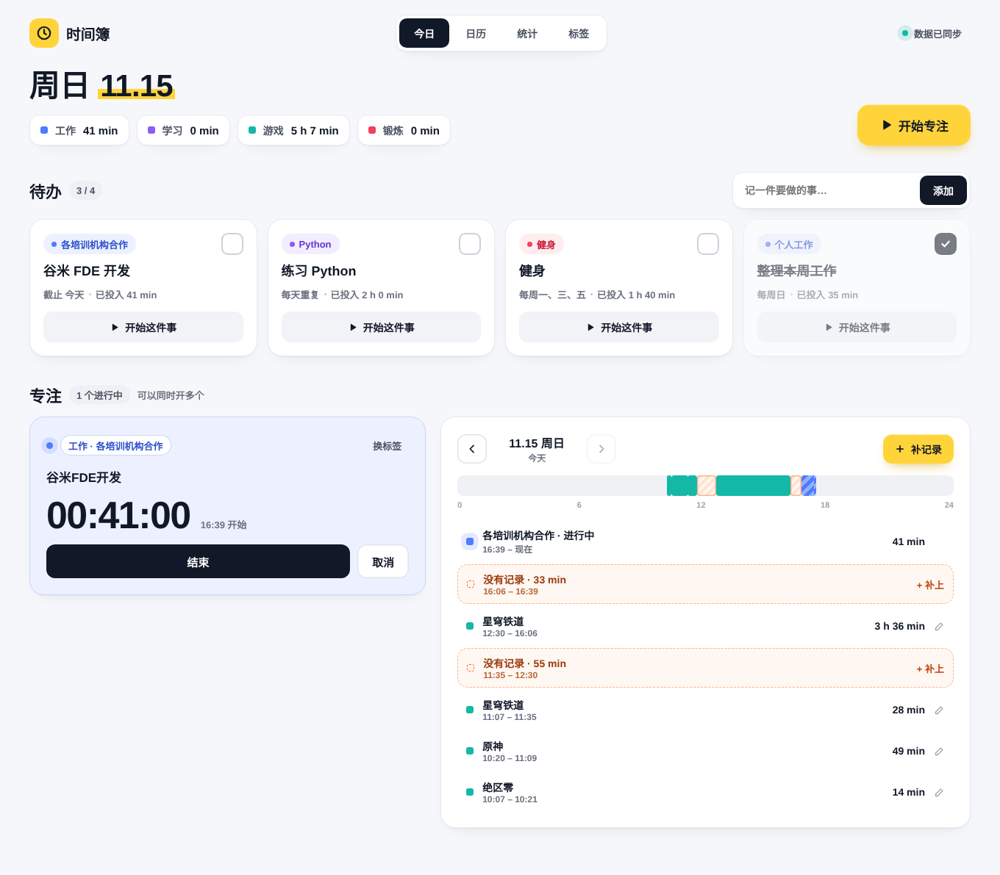
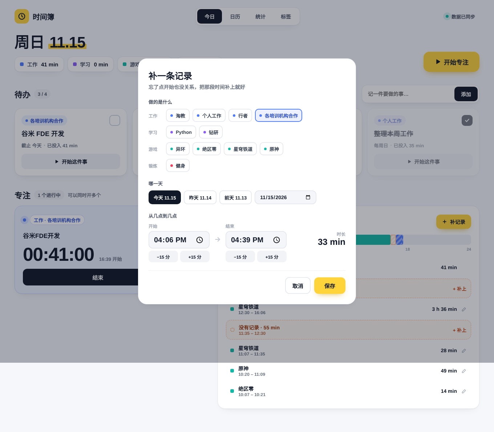
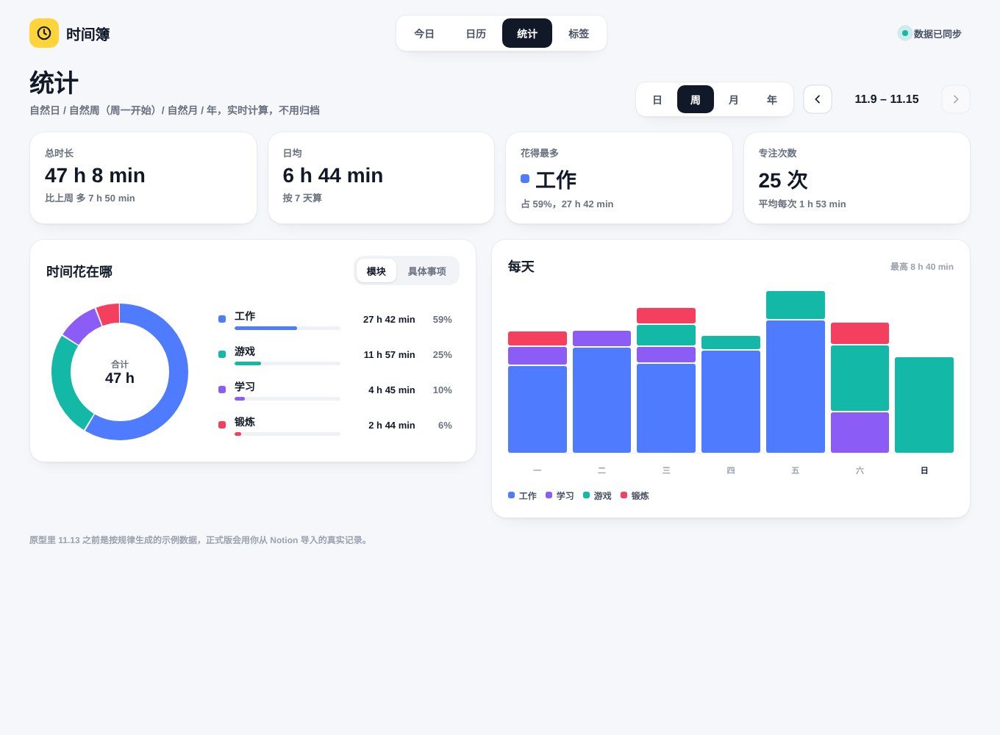
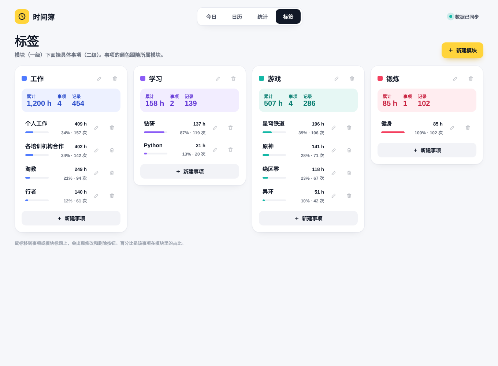

# 时间簿 Timebook

个人时间记录与可视化工具，用来替代原来在 Notion 里搭的「个人时间可视化管理」。

- 多个计时可以同时进行，先开始、再选标签
- 自动标出漏记的空档，一点就补；日历里拖一下也能补
- 日 / 周 / 月 / 年统计实时计算，不用归档
- 模块与事项两级标签，可增删改，删除时可迁移记录
- 多设备同步，右上角「数据已同步」随时监控数据是否安全保存

## 文档

- [开发方案](docs/开发方案.md)：需求规则、数据模型、架构与部署、同步、导入、里程碑、待确认问题
- [设计规范](docs/设计规范.md)：颜色角色、字号、圆角、阴影、动效

## 原型

`prototype/` 里是交互原型的源码（Claude 设计画布格式，需要在画布里运行，这里仅作开发参考）。截图：

| 今日 | 补记录 |
| --- | --- |
|  |  |

| 日历（拖动补记录） | 统计 |
| --- | --- |
|  |  |

| 标签 | 删除事项 |
| --- | --- |
|  |  |

## 状态

原型已定稿，开发尚未开始。下一步见[开发方案 · 第 11 节](docs/开发方案.md#11-开发里程碑)与[第 12 节待确认问题](docs/开发方案.md#12-需要你确认的问题)。
